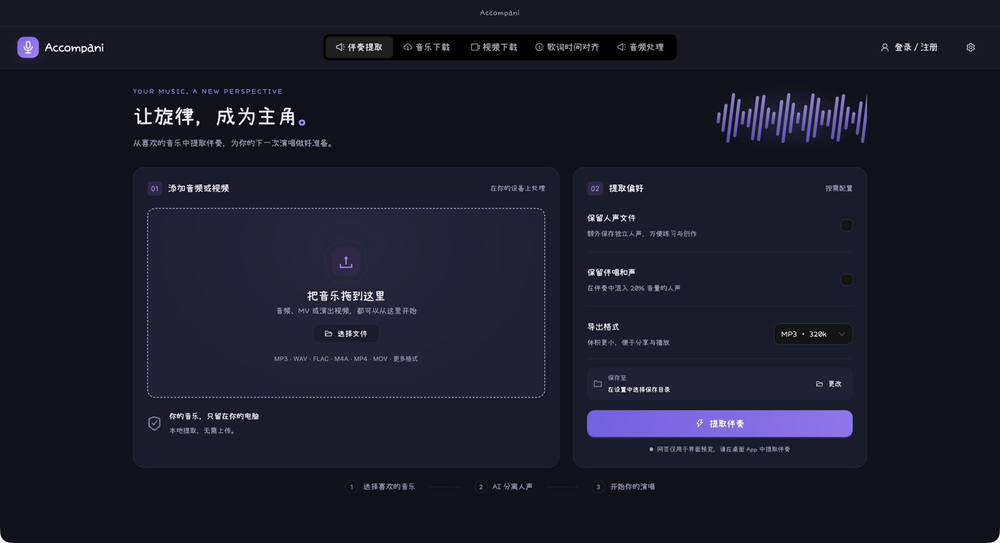
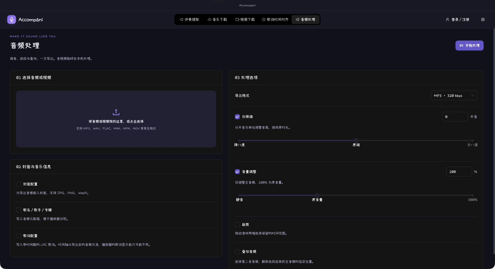
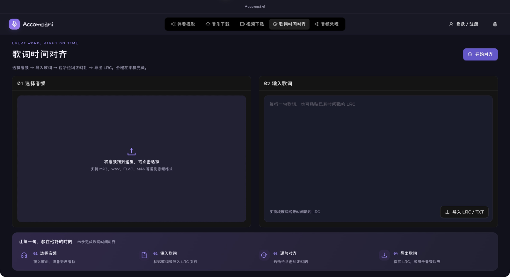

  
  <h1>Accompani</h1>
  
<strong>让旋律，成为主角。</strong>

  
提取伴奏 · 获取音视频 · 调整音频 · 校准歌词

  
为练唱、翻唱和日常音频创作准备的一间桌面工作室。

  

    
    
    
  

  
macOS · Windows｜本地音频处理｜浅色 / 深色主题

## 从一首喜欢的歌开始

想练唱，却找不到合适的伴奏？想把一段音频降调、裁短，再加上自己的封面？Accompani 把这些常用操作放在一起，让你把时间留给音乐。

- **准备伴奏**：拖入音频或视频，分离伴奏和人声，按需导出。
- **找到素材**：搜索音乐，或粘贴视频链接、分享文案获取音视频。
- **调整音频**：升降调、调整音量、截取片段、叠加第二条音轨。
- **整理歌曲信息**：裁剪封面，填写歌名、歌手、专辑，嵌入歌词。
- **让歌词跟上节奏**：一边播放，一边逐句纠正时间，保存为 LRC。

## 五个页面，覆盖常用工作流

| 功能             | 可以做什么                                                                 |
| ---------------- | -------------------------------------------------------------------------- |
| **伴奏提取**     | 从本地音频或视频中分离伴奏，可同时保存独立人声；支持 MP3、WAV、FLAC        |
| **音乐下载**     | 按歌曲、歌手、专辑搜索，试听并下载歌曲、封面或歌词，支持平台筛选与平台登录 |
| **视频下载**     | 解析网页链接和分享文案，预览视频，优先获取平台可用的最高画质，展示下载进度 |
| **歌词时间对齐** | 导入纯文本或已有 LRC，边听边纠正时刻；支持增删行、修改内容、对比变化和导出 |
| **音频处理**     | 格式转换、升降调、音量调整、裁剪、叠加，以及封面、音乐信息和歌词配置       |

### 伴奏提取：为下一次演唱做好准备

拖入一首歌或一段视频，选择输出格式，点击“提取伴奏”。处理进度清晰可见，完成后可以直接试听、打开输出目录。

需要带一点人声练习时，可以勾选“保留伴唱和声”，在伴奏中混入 **20% 音量的人声轨**；也可以单独保存人声。该选项混入的是分离出的人声，不会单独识别主唱与和声。

### 音频处理：把声音调成适合自己的样子

- **升降调**：以半音为单位调整，支持 ±12 半音，保持时长。
- **音量调整**：支持 0%–300%，100% 为原音量。
- **裁剪与叠加**：通过滑块选择起止时间，把另一段音频放到指定位置；支持试听实际叠加效果。
- **封面与音乐信息**：1:1 封面裁剪，填写歌名、歌手、专辑，嵌入带时间戳的歌词。
- **多种格式**：导出 MP3、WAV、FLAC、M4A；封面和歌词支持 MP3、FLAC、M4A。

### 歌词时间对齐：让每一句，都在恰好的时刻

选择歌曲、粘贴歌词，进入校准页面。播放时点击对应歌词的“纠正时刻”，把当前播放时间记到这一句；也可以手动修改时间、插入或删除歌词行。

完成编辑后跟随音乐预览，查看修改前后的差异，再导出 LRC，或直接用于音频处理。

> 截图来自当前版本的真实界面预览，具体样式以安装版本为准。音视频处理和下载请在桌面 App 中使用。

## 下载与安装

前往 **[GitHub Releases](https://github.com/ihezebin/accompani/releases)**，按系统和处理器选择已发布的安装包。

| 系统        | 推荐安装方式                                                            |
| ----------- | ----------------------------------------------------------------------- |
| **macOS**   | 下载 DMG，打开后将 Accompani 拖入 Applications；也可使用包含 App 的 ZIP |
| **Windows** | 下载安装 EXE，按引导安装；便携 ZIP 需完整解压后启动，系统需有 WebView2  |

macOS 最低支持 macOS 12。Apple Silicon 和 Intel Mac 请分别选择对应架构的安装包，具体可用平台以 Release 附件为准。

安装包包含音频处理所需引擎，无需另外安装 Python、Go 或 FFmpeg。之后可在 **设置 → 关于** 检查新版并升级。

## 免费试用与永久使用

使用邮箱验证码登录，首次登录自动注册。

- **免费试用**：新账号可获得体验额度，多项功能共享使用。
- **邀请赠送**：邀请新用户注册，可获得额外体验额度。
- **永久使用**：可在“账号权益”中购买 **Accompani 永久使用**。

具体赠送次数、剩余额度和购买价格，以 App 内“账号权益”页面展示为准。

## 常见问题

**音频会上传吗？**

伴奏分离、音频处理和歌词校准在本机完成，选中的本地音视频不会上传处理。账号登录、权益和平台下载需要联网。

**可以完全去掉人声吗？**

分离效果取决于原始录音、混音和混响，部分歌曲可能残留人声或产生处理痕迹。建议先试听结果，再用于演唱或创作。

**下载的音乐和视频保存在哪里？**

在“设置 → 保存设置”中分别配置各功能的输出目录，完成后可直接打开文件夹。

**所有平台的资源都能下载吗？**

资源是否可用取决于来源平台、账号权限和资源状态。需要登录的平台可在 App 内配置平台登录；下载功能不会提供额外的平台会员权限。

## 反馈与作者

遇到问题或有功能建议，欢迎提交 [Issue](https://github.com/ihezebin/accompani/issues)。请附上 App 版本、操作系统和复现步骤，方便定位。

由 **[hezebin.com](https://hezebin.com)** 开发。

如果 Accompani 帮你完成了一次练唱或创作，欢迎点亮一颗 ⭐。
