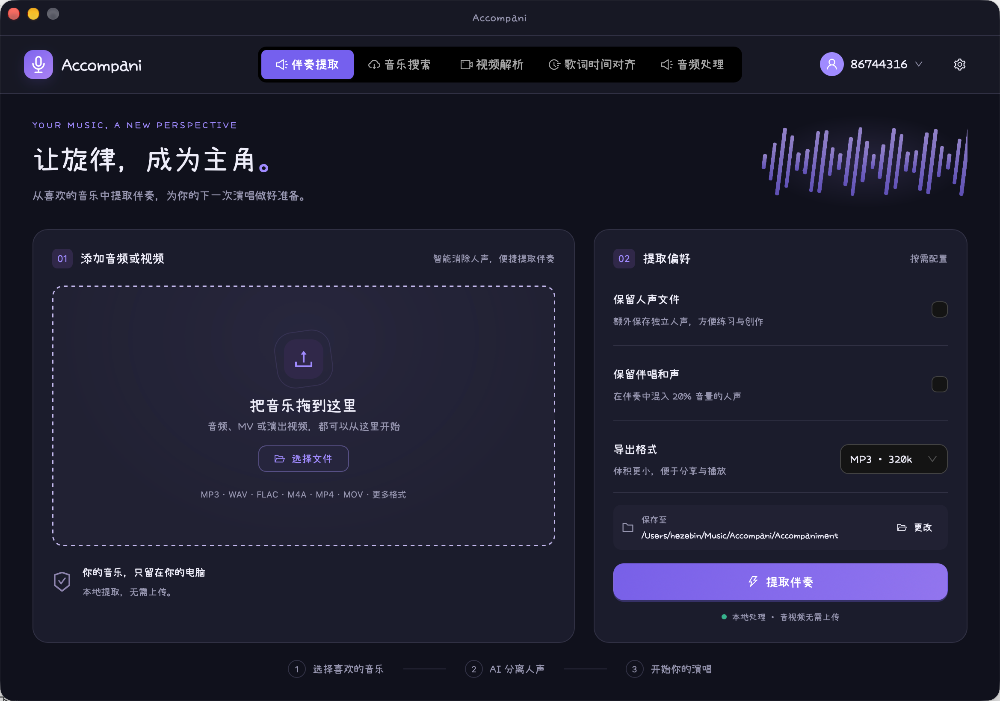
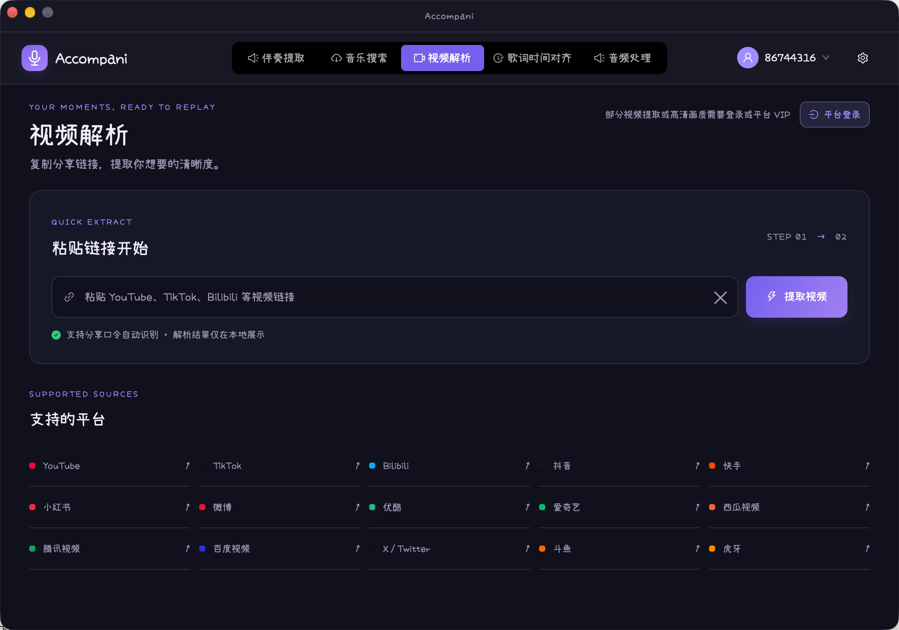
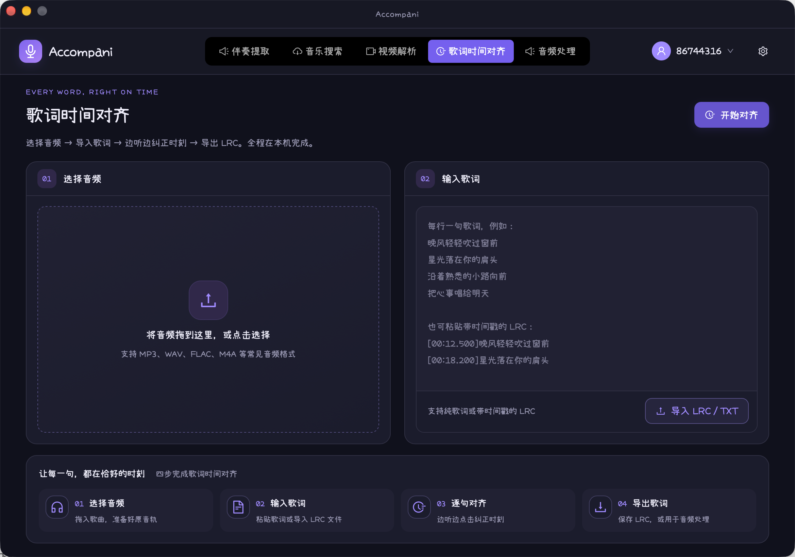
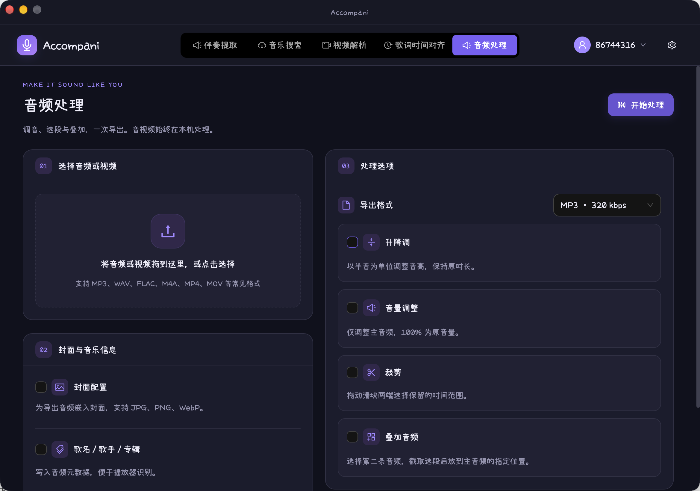
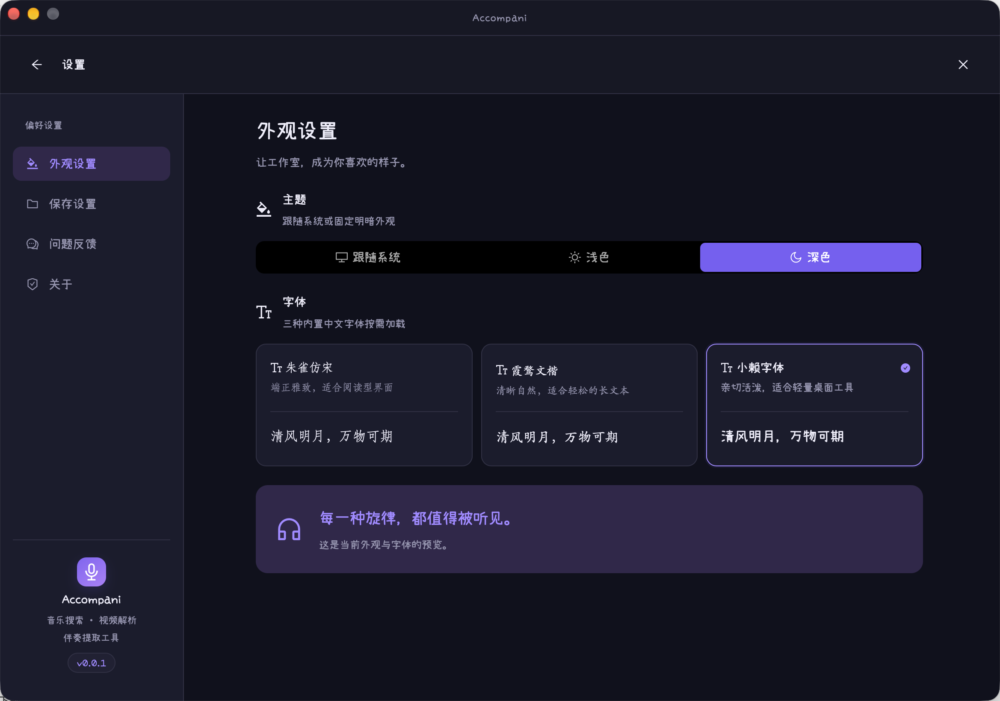

  
  <h1>Accompani</h1>
  
<strong>每一种旋律，都有你的可能。</strong>

  
从一首喜欢的歌，到属于你的创作。 提取伴奏、获取素材、打磨音频、校准歌词，在一个桌面工作室里完成。

  

    
    
  

  
macOS · Windows &nbsp; / &nbsp; 本地音频处理 &nbsp; / &nbsp; 浅色与深色主题

  
<a href="#功能亮点">功能亮点</a> · <a href="#功能截图">功能截图</a> · <a href="#下载与开始使用">下载与安装</a> · <a href="https://github.com/ihezebin/accompani/issues">反馈与建议</a>

---

## 让灵感少一点等待

练唱前，准备一份适合自己的伴奏；翻唱时，把音调调整到舒服的音域；整理作品时，让封面、歌曲信息和歌词一起就位。

Accompani 把这些常用工具放在同一个地方。无论是认真练习一首歌，还是尝试新的创作，你都可以从熟悉的音乐开始。

## 功能亮点

| | 为你的创作多做一步 |
| --- | --- |
| **🎙️ 伴奏提取** | 导入音频或视频，分离人声与伴奏。练唱、翻唱，或单独保存人声，为下一次创作准备素材。 |
| **🎵 音乐搜索与下载** | 按歌曲、歌手或专辑寻找音乐，试听后保存需要的歌曲、封面与歌词，让灵感随手可得。 |
| **🎬 视频素材获取** | 粘贴视频链接或分享文案，解析、预览并下载可用素材，减少来回切换。 |
| **🎚️ 音频处理** | 升降调、调整音量、裁剪片段、叠加音轨与转换格式，把声音调成适合自己的样子。 |
| **📝 歌词时间对齐** | 跟随音乐逐句校准歌词，预览调整效果并导出 LRC，让每一句都恰好入拍。 |
| **💿 作品信息整理** | 裁剪封面、编辑歌名与歌手信息、嵌入歌词，让保存下来的每一首歌都更完整。 |

### 你的音乐，留在你的电脑

伴奏分离与音频处理在本机完成，无需将本地音视频上传处理。安装包已包含所需处理引擎，安装后即可使用，无需额外搭建运行环境。

### 从导入到导出，每一步都看得见

查看处理进度，试听输出结果，再保存到自己的文件夹。支持 MP3、WAV、FLAC 等常用格式，方便继续编辑、练习或播放。

### 让工作室，也有你的风格

在浅色与深色主题之间切换，选择喜欢的字体。从白天的整理到夜晚的练唱，用舒服的界面陪伴创作。

## 功能截图

### 伴奏提取 · 听见音乐的另一面

导入一首喜欢的歌，让伴奏成为下一次演唱的起点。

### 音乐搜索与下载 · 让灵感随手可得

从搜索到试听，找到这一次创作需要的音乐。

### 视频素材获取 · 留住喜欢的片段

粘贴分享链接，预览并保存需要的视频素材。

### 歌词时间对齐 · 让每一句恰好入拍

一边听，一边校准，让文字跟上旋律。

### 音频处理 · 调成你的节奏

调整音调与音量，剪出喜欢的片段，打磨属于你的声音。

### 主题与字体 · 让工作室也有你的风格

选择适合自己的明暗主题与字体，让创作更自在。

## 下载与开始使用

前往 **[最新版本下载页 →](https://github.com/ihezebin/accompani/releases/latest)**，选择适合设备的安装包。

| 你的设备 | 选择的安装包 | 安装方式 |
| --- | --- | --- |
| **Mac · Apple Silicon**（M 系列芯片） | 文件名含 `aarch64` 的 `.dmg` | 打开安装包，将 Accompani 拖入 Applications。 |
| **Mac · Intel** | 文件名含 `x64` 的 `.dmg` | 打开安装包，将 Accompani 拖入 Applications。 |
| **Windows · 64 位** | 文件名以 `_x64_setup.exe` 结尾 | 双击安装包，按安装引导完成。 |

macOS 需为 **12 或更新版本**。可下载的安装包以当前版本页面为准；Windows 请使用 `setup.exe` 安装引导包。

**开始第一段创作：**

1. **导入素材**：选择本地音视频，或使用音乐、视频下载功能获取素材。
2. **按需处理**：提取伴奏、调整音频，或校准歌词时间。
3. **试听并保存**：确认结果，保存到自己指定的文件夹。

后续可在 App 的 **设置 → 关于** 中检查更新。

## 先体验，再决定

新用户可获得体验额度，先用熟悉的歌曲试试效果。喜欢 Accompani，也可以通过邀请获得额外额度，或在 App 内购买永久使用权益。

体验额度、邀请奖励与购买价格，以 App 内 **账号权益** 页面展示为准。

## 你可能想了解

<strong>需要联网吗？音频会上传吗？</strong>

伴奏分离、音频处理和歌词校准在本机完成，本地音视频无需上传处理。账号登录、权益验证以及在线音乐、视频下载需要联网。

<strong>每首歌都能完全去掉人声吗？</strong>

分离效果会受到录音、混音与混响的影响，部分歌曲可能仍有少量人声残留或处理痕迹。建议先试听结果，再用于练唱或创作。

<strong>文件保存在哪里？</strong>

可以在「设置 → 保存设置」中配置各功能的输出目录，处理完成后直接打开文件夹。

<strong>下载功能支持所有资源吗？</strong>

资源可用性取决于来源平台、账号权限及资源状态。部分资源需要先在 App 内登录对应平台；Accompani 不会提供额外的平台会员权限。

---

  
<strong>每一种旋律，都值得被听见。</strong>

  
<a href="https://github.com/ihezebin/accompani/releases/latest">↓ 下载 Accompani</a> &nbsp; · &nbsp; <a href="https://github.com/ihezebin/accompani/issues">💬 问题反馈</a> &nbsp; · &nbsp; <a href="https://hezebin.com">↗ 关于作者</a>

  
如果 Accompani 陪你完成了一次练唱或创作，欢迎留下一颗 ⭐。

